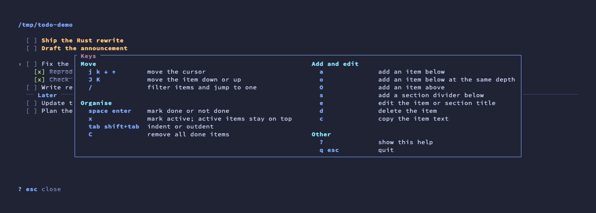

# todo

A simple per-directory todo list.

`todo` keeps a todo list for each directory you work in, stored together in one Markdown file. Use the CLI from scripts and the shell, or the TUI to work through your list.


## Features

- **Per-directory lists:** items belong to the directory where you run `todo`, so each project gets its own list.
- **Plain Markdown storage:** one human-readable file you can edit, diff, or sync.
- **Structure:** nest items up to five levels and group them with titled section dividers.
- **Active items:** mark what you are working on now; active items stay at the top.
- **Daily cleanup:** done items are removed on the first `todo list` or `todo tui` of a new day.
- **Interactive TUI:** keyboard-driven, with fuzzy filtering, and colours from your terminal theme.

## Installation

### Homebrew

```bash
brew install juanibiapina/taps/todo
```

### Shell installer

```bash
curl --proto '=https' --tlsv1.2 -LsSf https://github.com/juanibiapina/todo/releases/latest/download/todo-installer.sh | sh
```

### Cargo

```bash
cargo install --git https://github.com/juanibiapina/todo
```

### From source

```bash
make build    # builds to dist/todo
make install  # cargo install
```

### Shell completion

```bash
todo completion zsh > "${fpath[1]}/_todo"   # also: bash, fish, elvish, powershell
```

## Usage

### Add an item

```bash
todo add Buy groceries
todo add Fix the login bug
```

### Add a section divider

Sections are visual dividers that group items. They can't be checked or cleaned. A section may have a title, which appears inline with the divider.

```bash
todo add --section            # untitled divider
todo add -s Planning          # titled divider
```

Use `todo edit <id> <title>` to rename a section.

### List items

```bash
todo list    # or just: todo
```

```
3 [ ] Call dentist  (active)
1 [ ] Buy groceries
2   [ ] Pick up milk
── Later ─────────────────────
5 [ ] Renew passport
```

Each line starts with the item's ID, its position in the directory's list; sections count as positions too. Active items come first. Indented items show extra spacing before the checkbox. Checking an item as done clears its active status.

### Edit an item

```bash
todo edit 1 Buy eggs instead
```

### Check / uncheck items

```bash
todo check 1
todo uncheck 1
```

### Delete checked items

```bash
todo clean
```

## Interactive TUI

```bash
todo tui
```

The header shows the directory. The footer shows the main keys for the current mode. Press `?` for all keys:



| Key | Action |
| --- | --- |
| `j` `k` `↓` `↑` | Move the cursor |
| `J` `K` | Move the item down or up |
| `space` `enter` | Mark done or not done |
| `x` | Mark active; active items stay on top |
| `tab` `shift+tab` | Indent or outdent |
| `a` | Add an item below |
| `o` | Add an item below at the same depth |
| `O` | Add an item above |
| `s` | Add a section divider below |
| `e` | Edit the item or section title |
| `d` | Delete the item |
| `c` | Copy the item text |
| `C` | Remove all done items |
| `/` | Filter items and jump to one |
| `?` | Show all keys |
| `q` `esc` | Quit |

While adding or editing, `enter` or `esc` saves, `ctrl+c` cancels, and `tab`/`shift+tab` set the new item's depth. While filtering, `↑`/`↓` or `ctrl+n`/`ctrl+p` move through matches.

The TUI uses your terminal's 16-colour palette, so it follows your terminal theme on light and dark backgrounds.

## Storage

Items are stored in one Markdown file, human-readable and editable with any text editor.

### Markdown format

```markdown
## ~/project-a

- [ ] Fix the login bug
  - [ ] Reproduce locally
    - [ ] Check server logs
---
- [ ] Deploy to staging
--- Later
- [ ] Update the homepage

## ~/project-b

- [x] Write tests
- [ ] Update docs @active
```

Each directory gets a `## heading`. Items use Markdown checkboxes (`- [ ]` / `- [x]`). Indented items use nested list syntax (2 spaces per level, up to 5 levels). Section dividers are `---`, or `--- Title` when titled. Active items end with `@active`. A `<!-- last-clean: YYYY-MM-DD -->` comment under a heading records the last daily cleanup.

### File location

Default: `~/.local/share/todo/todo.md`

Override with the `TODO_FILE` environment variable:

```bash
export TODO_FILE=~/todo.md
```

The value supports environment variable expansion (`$HOME`, `$MY_VAR`) and `~` for the home directory.

## Development

```bash
make build            # Build binary to dist/todo
make test             # Run all checks (lint + unit + integration)
make lint             # Run rustfmt and clippy
make unit-test        # Run Rust unit tests
make integration-test # Run bats integration tests
make demo             # Record assets/demo.gif and assets/help.png (needs vhs)
```
